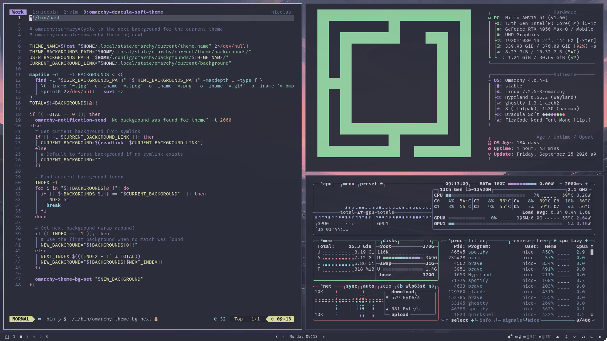

# Dracula Soft

A low-contrast take on [Dracula](https://draculatheme.com) for [Omarchy](https://omarchy.org), easier on the eyes for long sessions.



## Install

```bash
omarchy theme install https://github.com/unwrap-nicolas/omarchy-dracula-soft-theme
```

## Wallpapers

Recolored to the Dracula Soft palette with [gowall](https://github.com/Achno/gowall), from Omarchy's stock backgrounds: Totoro (Catppuccin), Winding Road and Quattro (Tokyo Night).
